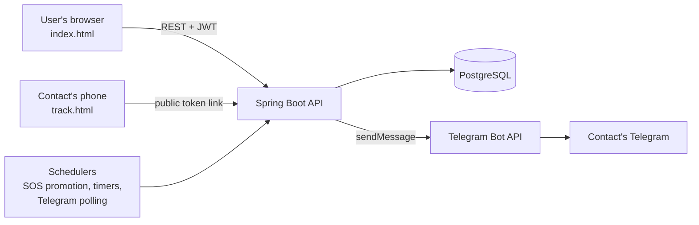
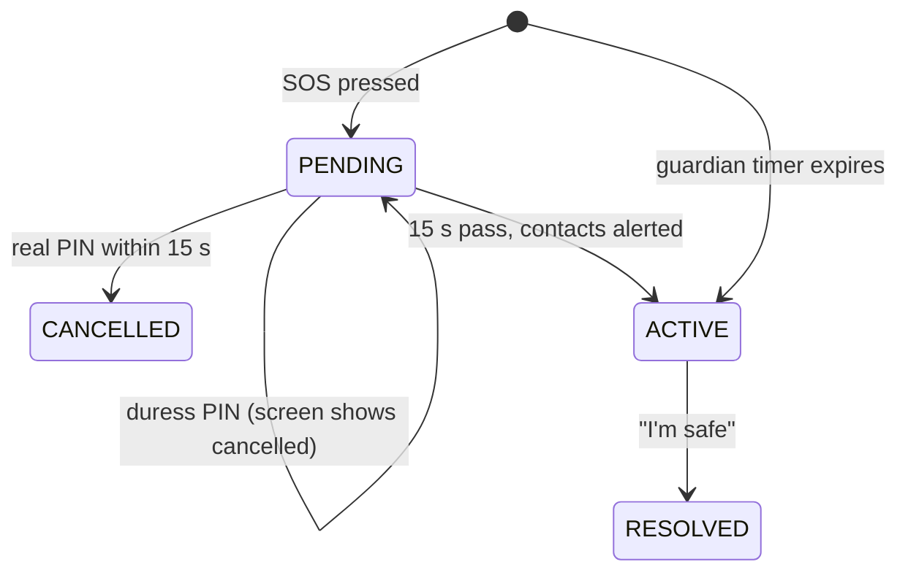

# Companio

Companio is a personal-safety prototype. A user presses SOS, gets 15 seconds to cancel with a PIN, and if they do not cancel, their trusted contacts are alerted on Telegram with a live tracking link that shows where the user is.

> **Status: working prototype, not a certified safety product.** Do not rely on it in a real emergency. See [Limitations](#limitations).

## What it does

- **SOS with a cancel window.** Pressing SOS starts a 15-second countdown. The user can cancel with their PIN. Otherwise the SOS becomes ACTIVE and contacts are alerted.
- **Duress PIN.** A second PIN that looks like a normal cancel on screen, but the server keeps the alert running. It is for when someone forces the user to cancel.
- **Live tracking link.** Each SOS has a random link (`/track.html?t=...`). Contacts open it without an account and see the user's first name and latest position, refreshed every 5 seconds. The link stops working as soon as the SOS ends.
- **Live location.** While an SOS is ACTIVE, the web page sends the browser's position to the server every 10 seconds.
- **Guardian timer.** The user sets how long a journey should take. If they do not check in before it ends, an SOS starts automatically, without the cancel window.
- **Trusted contacts.** Up to 5 per user, with add, edit and delete.
- **Telegram alerts.** Each contact connects once through a personal link, then receives alerts in their own Telegram.

## Architecture



**Stack:** Java 21, Spring Boot, Spring Security with JWT, Spring Data JPA, PostgreSQL, BCrypt, plain HTML and JavaScript for the web client.

## SOS lifecycle



## Run it locally

**Requirements:** Java 21, PostgreSQL, and (optional) a Telegram bot.

1. Create an empty PostgreSQL database.
2. Copy `src/main/resources/application.properties.example` to `src/main/resources/application.properties` and fill in your own values. This file is ignored by Git, so your secrets stay on your machine.

   | Setting | Purpose |
   |---|---|
   | `spring.datasource.url`, `.username`, `.password` | Your PostgreSQL connection |
   | `jwt.secret` | A random string of at least 32 characters |
   | `telegram.bot-token` | From @BotFather (optional) |
   | `telegram.bot-username` | Your bot's username, without `@` (optional) |
   | `companio.public-base-url` | Address that goes into alert links, `http://localhost:8080` by default |

3. Start the server:

   ```
   ./mvnw spring-boot:run
   ```

   On Windows use `.\mvnw.cmd spring-boot:run`.
4. Open `http://localhost:8080`, create an account, set your PINs in **Settings**, and add a contact.

### Telegram alerts

1. In Telegram, message `@BotFather`, send `/newbot`, and copy the token into `telegram.bot-token`.
2. Put the bot's username in `telegram.bot-username` and restart the server.
3. In the app, open **Contacts**. Each contact has a **Connect Telegram** link. The contact opens it on their own phone and taps **Start**. Within a few seconds the contact shows "Telegram connected".
4. Contacts who have not connected only appear in the server log.

### Testing on a phone

Phones cannot reach `localhost`, and browsers only share location over HTTPS. For testing, a temporary tunnel works:

```
cloudflared tunnel --url http://localhost:8080
```

Put the address it prints into `companio.public-base-url`, restart the server, and open the app through that address. The address changes every time the tunnel starts, and while it runs your login page is public, so use a strong password and close the tunnel when you finish.

## API summary

| Method and path | Auth | Purpose |
|---|---|---|
| `POST /api/users` | No | Register |
| `POST /api/auth/login` | No | Log in, returns a JWT |
| `GET /api/users/me` | Yes | Own profile only |
| `PUT /api/users/me/pins` | Yes | Set PIN and duress PIN |
| `GET/POST /api/contacts`, `PUT/DELETE /api/contacts/{id}` | Yes | Trusted contacts |
| `POST /api/sos/trigger` | Yes | Start an SOS |
| `GET /api/sos` | Yes | Own SOS history |
| `PUT /api/sos/{id}/cancel` | Yes | Cancel with PIN or duress PIN |
| `PUT /api/sos/{id}/resolve` | Yes | Mark safe |
| `POST /api/sos/{id}/location` | Yes | Send a position update |
| `POST /api/guardian-timer/start`, `PUT /api/guardian-timer/check-in` | Yes | Guardian timer |
| `GET /api/track/{token}` | No | Public tracking data, only while ACTIVE |

## Security

- Passwords and PINs are hashed with BCrypt. JWTs expire after 24 hours.
- Every SOS, contact and timer is scoped to its owner. Another user gets a 404.
- Tracking links are random 122-bit tokens, shown only while the SOS is ACTIVE, and expose only the first name and position.
- Request bodies are validated and errors use one JSON format.
- Rate limits per IP address, per minute: 10 logins, 5 registrations, 5 SOS triggers.
- Secrets live in `application.properties`, which is not in Git.

## Tests

```
./mvnw test -Dtest=CriticalLogicTests
```

Six automated tests cover the real PIN cancelling an SOS, the duress PIN keeping it alive, a wrong PIN being rejected, one user being unable to cancel another's SOS or edit another's contact, and the tracking link refusing a PENDING SOS. The rate limiter was checked by hand: the eleventh login attempt in a minute returns 429.

## Limitations

- **Web prototype only.** There is no mobile app, so there is no background location, no locked-screen use and no shake trigger. Live location stops if the browser tab is closed, and Chrome slows hidden tabs, so the page must stay visible.
- **Alerts reach Telegram users only.** A contact must connect Telegram once. There is no WhatsApp or SMS delivery yet.
- **No permanent hosting.** The tracking link needs a tunnel, and its address changes each run. Free hosting tiers sleep when idle, which would stop the guardian timer and SOS promotion jobs, so a real launch needs an always-on plan.
- **Rate limiting is in memory.** Counts reset on restart and do not work across several servers.
- **Test coverage is partial.** The guardian timer and notification code have no automated tests.
- **Location accuracy.** Laptop browsers report approximate positions, so coordinates may barely move.

## Roadmap

1. Host the backend on an always-on server with HTTPS and a managed PostgreSQL.
2. Android app: foreground location service, shake trigger, and an offline SMS fallback sent from the phone's own SIM.
3. WhatsApp and server-side SMS so contacts do not need Telegram. In India, SMS needs DLT registration and WhatsApp needs approved message templates.
4. On-device scream detection with a TensorFlow Lite model. A high score would start the same cancelable SOS rather than alert contacts directly.

## ML prototype

The `ml/` folder contains a scream-detection prototype: YAMNet audio embeddings with a logistic-regression classifier, trained and evaluated on a public screaming dataset. It is a separate experiment and is **not connected to the backend**. At the permissive threshold, precision was only about 70%, so a model like this should only start a cancelable SOS, never alert contacts on its own. Real-world accuracy is unknown because the data was public recordings, not real emergencies. See `ml/` for the notebooks and results.

## License

No license has been chosen yet, so by default all rights are reserved. Add a license file before inviting reuse.