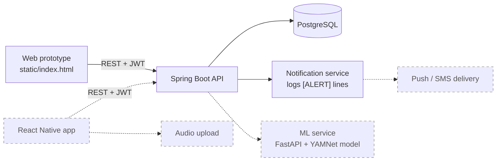
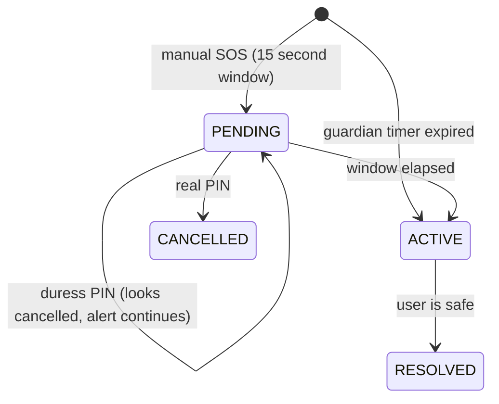

# Companio

A women's safety backend that lets a user alert the people they trust, with an SOS that can be cancelled safely, a guardian timer that raises the alarm if you don't check in, and a prototype scream detector for a future hands-free trigger.

Final-year project, BCA (AI & Data Science). Built by [@IshaShrivastava25](https://github.com/IshaShrivastava25).

> **Status: working prototype, not a safety product.** Alerts to contacts are simulated, there is no mobile app yet, and the ML model is not connected to the backend. Do not rely on it in a real emergency.

## What works today

| Area | Status |
|---|---|
| Accounts, BCrypt password hashing, JWT login | Built and tested |
| Trusted contacts (add, edit, delete, up to 5) | Built and tested |
| SOS with a 15-second cancel window | Built and tested |
| PIN cancel and **duress PIN** | Built and tested |
| Guardian timer with a background scheduler | Built and tested |
| Input validation and clean 400/401/404/409 errors | Built and tested |
| Per-user data isolation (checked with two accounts) | Built and tested |
| Web prototype of the app screens (`static/index.html`) | Built |
| Scream detection model (YAMNet embeddings + logistic regression) | Trained and evaluated in Colab, **not integrated** |
| Alerts to contacts | **Simulated:** the server prints who it would notify |
| React Native app, shake trigger, fake call, offline SMS, 112 dial | Planned |
| Real push/SMS delivery, audio upload | Planned |

## How it works

Solid boxes exist today; dashed boxes are planned.



### The SOS lifecycle



- A **manual SOS** starts as `PENDING`. If nobody cancels it within 15 seconds, a scheduler (every 5 seconds) promotes it to `ACTIVE` and the notification service alerts the user's trusted contacts.
- A **guardian timer** SOS skips the window and goes straight to `ACTIVE`, because the user already missed their check-in.
- The **duress PIN** is for someone forced to cancel. The response looks like a normal cancel, but the server keeps the SOS running.
- Only a `PENDING` SOS can be cancelled, and only an `ACTIVE` one can be resolved. Anything else returns 409.

### Guardian timer

The user sets a duration and checks in when they arrive. A scheduler runs every 60 seconds. For each expired timer it fires the SOS first and marks the timer expired afterwards, so a failed SOS is retried on the next run. If a timer expired more than 5 minutes ago (for example, the server was down), it is closed without sending a stale alert.

## Security notes

- Passwords are stored as BCrypt hashes. API responses use DTOs, so a hash can never be returned.
- Login issues a signed JWT (HS256, 24 hours). The server reads the user from the token, never from the request body.
- A user asking for someone else's event or contact gets **404**, the same as one that does not exist, so IDs cannot be probed.
- Registration accepts a dedicated request object, so extra fields (such as a PIN hash) cannot be injected.
- CSRF protection is disabled because the API is stateless and uses an `Authorization` header, not cookies.
- Secrets stay out of Git: `application.properties` is ignored, and `application.properties.example` is the template.

## API

All routes except registration and login need the header `Authorization: Bearer <token>`.

| Method | Path | Purpose |
|---|---|---|
| POST | `/api/users` | Register: `name`, `email`, `password` (8 to 72 characters), `phoneNumber` (7 to 15 digits, optional) |
| POST | `/api/auth/login` | Log in with `email` and `password`, returns `{"token": "..."}` |
| GET | `/api/users/me` | The signed-in user's details |
| PUT | `/api/users/me/pins` | Set `pin` and `duressPin` (4 to 6 digits each, different from each other) |
| GET, POST | `/api/contacts` | List or add a trusted contact (maximum 5) |
| PUT, DELETE | `/api/contacts/{id}` | Edit or delete a contact |
| POST | `/api/sos/trigger` | Start an SOS: `latitude`, `longitude` |
| GET | `/api/sos` | The user's SOS history |
| PUT | `/api/sos/{id}/cancel` | Cancel a pending SOS: `{"pin": "..."}` |
| PUT | `/api/sos/{id}/resolve` | Mark an active SOS as resolved |
| POST | `/api/guardian-timer/start` | Start a timer: `durationMinutes` |
| PUT | `/api/guardian-timer/check-in` | Check in and close the active timer |

Errors use standard status codes (400 validation or wrong PIN, 401 no or expired token, 404 not found, 409 wrong state) with a short message.

## Tech stack

Java 21, Spring Boot 4.1, Spring Security, Spring Data JPA (Hibernate), PostgreSQL, JJWT, Bean Validation, Maven wrapper. The ML prototype uses Python, TensorFlow Hub (YAMNet), scikit-learn and Google Colab.

## Getting started

**You need:** JDK 21 or newer, and PostgreSQL. Maven is not required, the wrapper is included.

```powershell
git clone https://github.com/IshaShrivastava25/Companio.git
cd Companio
```

1. **Create the database** (pgAdmin, or `psql -U postgres`): `CREATE DATABASE companio_db;`
2. **Create your config.** Copy `src/main/resources/application.properties.example` to `src/main/resources/application.properties` and fill it in:
   ```properties
   spring.datasource.url=jdbc:postgresql://localhost:5432/companio_db
   spring.datasource.username=postgres
   spring.datasource.password=YOUR_PASSWORD
   spring.jpa.hibernate.ddl-auto=update
   jwt.secret=CHANGE_ME_to_a_random_string_of_at_least_32_characters
   server.error.include-stacktrace=never
   server.error.include-message=never
   ```
3. **Run it:**
   ```powershell
   .\mvnw.cmd spring-boot:run        # Windows PowerShell / cmd
   ./mvnw spring-boot:run            # macOS or Linux
   ```

   If PowerShell blocks the Maven wrapper script, use a one-off policy change for this session:
   ```powershell
   Set-ExecutionPolicy -Scope Process -ExecutionPolicy Bypass
   .\mvnw.cmd spring-boot:run
   ```
4. **Open** <http://localhost:8080> for the web prototype, or call the API directly:
   ```powershell
   Invoke-RestMethod -Method POST -Uri http://localhost:8080/api/users -ContentType application/json `
     -Body '{"name":"Demo","email":"demo@example.com","password":"demo12345","phoneNumber":"9876543210"}'
   $r = Invoke-RestMethod -Method POST -Uri http://localhost:8080/api/auth/login -ContentType application/json `
     -Body '{"email":"demo@example.com","password":"demo12345"}'
   Invoke-RestMethod -Uri http://localhost:8080/api/users/me -Headers @{Authorization="Bearer $($r.token)"}
   ```

### The web prototype

`src/main/resources/static/index.html` is a single file with no dependencies, served by Spring Boot. It stands in for the planned mobile screens. A "behind the screen" panel lists the real API calls as you click, and presenter notes show what the server is doing, for example that a duress-PIN cancel still leaves the alert running.

## Project structure

```
src/main/java/com/companio/
  config/       security filter chain, JWT filter and utility
  controller/   REST endpoints
  dto/          request and response objects
  exception/    global exception handler
  model/        entities and status enums
  repository/   Spring Data JPA repositories
  service/      business logic, schedulers, notification service
src/main/resources/
  application.properties.example
  static/index.html
ml/
  notebooks/    Colab notebooks for feature extraction and evaluation
  models/       trained classifier and its metadata
```

## ML prototype: scream detection

**Goal:** estimate the probability that an audio clip contains a scream, so a future version could start or suggest an SOS without a button press.

**Data:** the [Human Screaming Detection Dataset](https://www.kaggle.com/datasets/whats2000/human-screaming-detection-dataset) on Kaggle (MIT licence): 3,493 clips, 862 screaming and 2,631 not. Stratified 70 / 15 / 15 split (2,445 / 524 / 524), fixed seed.

**Method:** transfer learning. Each clip is passed through [YAMNet](https://tfhub.dev/google/yamnet/1), a pretrained audio model, and its frame embeddings are averaged into one 1024-number vector. A logistic regression (standardised features, balanced class weights) is trained on those vectors. The decision threshold was chosen on the validation set, and the test set was evaluated afterwards.

**Test results** at threshold 0.20, 524 clips (129 screams), with 95% confidence intervals:

| Measure | Result |
|---|---|
| Screams caught (recall) | 121 of 129, 93.8% (88.2% to 96.8%) |
| Alerts that were real (precision) | 121 of 173, 69.9% (62.7% to 76.3%) |
| Harmless clips flagged | 52 of 395, 13.2% (10.2% to 16.9%) |
| ROC-AUC | 0.969 |

**Reading these honestly**
- 70% precision is too noisy to start an SOS on its own. The design uses three bands: a high score starts the SOS, a middle score asks the user to confirm, a low score is ignored.
- About a quarter of the clips are screams. Real screams are far rarer, so real-world precision would be much lower.
- The clips look like YouTube or AudioSet-style audio, and YAMNet was trained on AudioSet. If the dataset overlaps with it, these scores may be optimistic.
- The data is public recordings, not real emergencies. Phone microphones, distance and noise will lower accuracy. It detects screams only.
- There is no comparison against a no-training baseline yet.
- The model is not served by the backend. It is saved in `ml/models/` for a future FastAPI service.

Notebooks are in `ml/notebooks/`. `Companio_Train_Evaluate.ipynb` reads saved embeddings, compares four classifiers on validation data, and reports operating points with confidence intervals.

## Known limitations

- No rate limiting on login or PIN attempts. A four-digit PIN can be brute-forced by an attacker who holds a valid token.
- Alerts are printed in the server log. There is no SMS or push delivery, and no retry tracking.
- A guardian-timer SOS has no location.
- The schema is managed by `ddl-auto=update`. Adding a new enum value needed a manual change to a database constraint. Flyway migrations are the fix.
- If a scheduler promotion and a cancel arrive at the same moment, the last write wins. Optimistic locking would fix this.
- No automated tests yet.
- Login tokens last 24 hours and there are no refresh tokens.

## Roadmap

1. React Native app: shake-to-alert, fake incoming call, offline SMS fallback, one-tap 112 dial
2. Real delivery with Firebase push and SMS, with retries and delivery tracking
3. Audio chunk upload, and the ML model behind a FastAPI service called by the backend
4. Rate limiting, automated tests, Flyway migrations
5. Redis caching, WebSockets for live location, Docker, AWS deployment, CI/CD
6. Later: partnerships for police and NGO integration

## Credits and related work

- YAMNet and AudioSet, Google
- Human Screaming Detection Dataset, Ren-Di Wu, Kaggle (MIT licence)
- Scream detection with machine learning on AudioSet data, JMIR Formative Research, 2020 (PMC7327591)
